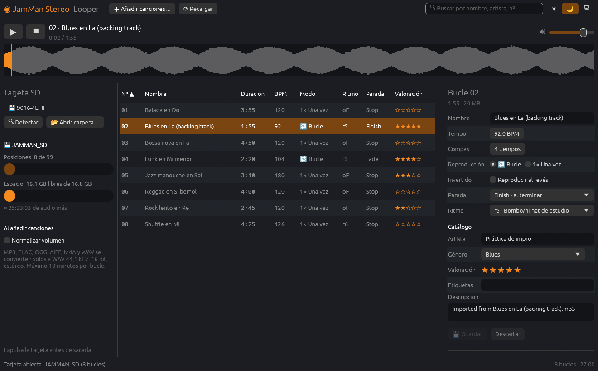

# jamman-stereo-looper

Herramienta libre y multiplataforma (Linux y Windows) para gestionar los bucles
del pedal **DigiTech JamMan Stereo**, pensada para sustituir al software
original (JamManager XT) cuando deje de funcionar.

Funciona de dos formas:

- **Con la tarjeta SD en el ordenador**, sin el pedal: las canciones se añaden,
  escuchan, editan y exportan directamente en la tarjeta.
- **Con el pedal conectado por USB**: se gestionan su memoria interna y la
  tarjeta que tenga puesta, y se hacen copias de seguridad.



> **Estado: en desarrollo.** La gestión de la tarjeta SD (interfaz gráfica y
> línea de comandos) funciona y está probada con una tarjeta real, y el pedal
> carga los bucles que escribe la app. El protocolo USB, deducido por ingeniería
> inversa, está **validado con el pedal** para listar, leer, escribir y borrar
> ([docs/03-protocolo.md](docs/03-protocolo.md)).

## Funciones

### Tarjeta SD
- Detecta sola la tarjeta del JamMan al conectarla (o se abre cualquier carpeta).
- Detecta también las **unidades vacías** montadas: **✨ Preparar** crea la
  carpeta `JamManStereo` tras pedir confirmación. No se borra ni se formatea
  nada.
- **Avisa si el pedal no podrá leer la tarjeta**: si no es FAT32 (exFAT, NTFS…)
  o tiene más de 32 GB, y explica cómo formatearla en el propio pedal
  (Shift + mantener Delete 4 s → «FO» → Delete → «F?» → mantener Delete 2 s →
  «Bu»; si muestra «nF», lo mismo con Store). La app nunca formatea. El tipo de
  sistema de ficheros solo se lee en Linux; en Windows y macOS solo se avisa
  por la capacidad.
- Muestra las posiciones ocupadas (de 99), el espacio libre y cuántos minutos de
  audio caben todavía.
- Lista los bucles con número, nombre, duración, tempo, bucle o una vez, ritmo,
  modo de parada y valoración. Se puede ordenar por columnas y buscar por
  nombre, artista, etiquetas o número.
- **💾 Copia de seguridad** de toda la tarjeta en una carpeta del equipo y
  **⤴ Restaurar** (igual que con el pedal).

### Explorador del equipo, como un cliente SFTP
- A la izquierda, las carpetas y el audio compatible del ordenador; a la
  derecha, la tarjeta.
- **Del equipo a la tarjeta**: selecciona canciones o carpetas y pulsa «➡ Añadir a
  la tarjeta», haz doble clic en una canción, usa «＋ Añadir canciones…» o
  arrastra ficheros a la ventana.
- **De la tarjeta al equipo**: selecciona bucles y pulsa «⬅ Exportar a la
  carpeta» para copiar sus WAV a la carpeta abierta en el explorador. Nunca se
  sobrescribe nada (se añade «(2)», «(3)»…).
- **Desde la posición**: el explorador propone el primer hueco libre y se puede
  cambiar. Las canciones van a los huecos libres a partir de ahí, saltando
  los ocupados; si la posición elegida está ocupada, no deja añadir.
- **Selección múltiple** en ambos lados: Ctrl+clic, Mayús+clic y Ctrl+A.
- Las transferencias van en segundo plano con barra de progreso; al terminar se
  resumen los errores, si los hay.

### Pedal por USB
- El selector de destino muestra, además de las tarjetas, la **memoria
  interna** y la **tarjeta del pedal** cuando está conectado.
- Con el pedal se puede lo mismo que con la tarjeta: listar, añadir desde el
  explorador (con conversión), exportar, borrar y editar los ajustes.
- **💾 Copia de seguridad**: copia todos los bucles, con sus ajustes, a una
  carpeta con el formato de la tarjeta (se puede abrir con 📂). **⤴ Restaurar**
  sube una copia al pedal, en sus mismas posiciones si están libres.
- Muestra el espacio libre que informa el pedal y **no sube nada que no
  quepa** (el pedal no avisa por sí mismo).
- Las operaciones van en segundo plano; el puerto solo se abre mientras duran.
  Si el pedal deja de responder, se para y se indica qué quedó sin copiar.
- Por USB no se puede escuchar ni mover bucles (habría que descargarlos
  enteros); para eso, saca la tarjeta o exporta.

### Conversión de audio automática
- MP3, FLAC, OGG, AIFF, M4A y WAV de cualquier frecuencia, resolución y número de
  canales se convierten al formato del pedal: WAV 44,1 kHz, 16 bit, estéreo.
- Normalización de volumen opcional (pico justo por debajo de 0 dB).
- Máximo 10 minutos por bucle, como el pedal.

### Escuchar
- Reproductor con forma de onda: doble clic en un bucle, barra espaciadora o ▶.
  Clic en la forma de onda para saltar a ese punto. Control de volumen.

### Editar cada bucle
Con los ajustes que describe el manual del pedal:
- Nombre, tempo (40–240 BPM), compás (2–15 tiempos), bucle o una vez,
  reproducción invertida.
- Modo de parada (Stop, Finish, Fade) y ritmo guía (oF, r1–r9).
- Catálogo: artista, género, valoración, etiquetas y descripción.
- «Guardar» (Ctrl+S) escribe solo lo que ha cambiado; avisa si cambias de bucle
  con cambios sin guardar.
- Mover un bucle a otra posición (si está ocupada, se intercambian), desde el
  panel de ajustes o **arrastrando un bucle sobre otro** en la tabla.
- Borrar uno o varios bucles (Supr), con confirmación.

### Seguridad de la tarjeta
- Los ficheros generados son idénticos byte a byte a los del software original.
- Un bucle nuevo se construye aparte y solo aparece al final: un fallo (audio
  inválido, tarjeta llena) no deja nada a medias.
- Al editar se conserva todo lo que no se toca, incluidos los bucles grabados en
  el propio pedal.
- **Comprueba lo copiado**: tras añadir o restaurar bucles, relee el audio y
  los XML **directamente de la tarjeta**, sin la caché del sistema (Linux:
  `O_DIRECT`; Windows: `FILE_FLAG_NO_BUFFERING`; macOS: sincroniza y relee). Si
  no coincide, avisa de que la tarjeta parece averiada: hay tarjetas que dan
  las escrituras por buenas sin guardarlas.
- Recuerda **expulsar la tarjeta** antes de sacarla del ordenador.

### Otros
- Tema oscuro, claro o el del sistema.
- Línea de comandos para todo lo de la tarjeta (ver abajo).

## Instalación

Requiere Rust 1.95 o superior. En Linux hacen falta las cabeceras de ALSA y
libudev (en Arch: `alsa-lib` y `systemd-libs`; en Debian/Ubuntu:
`libasound2-dev` y `libudev-dev`).

```bash
git clone https://github.com/javierjcf/jamman-stereo-looper.git
cd jamman-stereo-looper
cargo run --release -p jamman-gui
```

Para tener los comandos `jamman-gui` y `jamman` en el sistema:

```bash
cargo install --path crates/jamman-gui
cargo install --path crates/jamman-cli
```

## Interfaz gráfica

```bash
jamman-gui                      # abre la tarjeta si solo hay una; si no hay, el pedal
jamman-gui /ruta/a/la/tarjeta   # abre esa tarjeta (o su carpeta JamManStereo)
```

| Atajo | Acción |
|---|---|
| Clic / Ctrl+clic / Mayús+clic | Seleccionar uno / añadir o quitar / un rango |
| Ctrl+A | Seleccionar todos los bucles visibles |
| Doble clic | Bucle: escuchar · Canción del explorador: añadirla · Carpeta: entrar |
| Espacio | Escuchar o pausar |
| Supr | Borrar la selección (pide confirmación) |
| Ctrl+S | Guardar los ajustes del bucle |

## Línea de comandos

```bash
jamman card ls <tarjeta>                                 # lista los bucles
jamman card add <tarjeta> cancion.mp3                    # añade en la primera posición libre
jamman card add <tarjeta> cancion.flac --slot 30 --name "Mi canción" --normalize
jamman card rename <tarjeta> 30 "Otro nombre"
jamman card export <tarjeta> 30 copia.wav
jamman card mv <tarjeta> 30 12                           # mueve (o intercambia si 12 está ocupada)
jamman card rm <tarjeta> 30                              # pide confirmación (o --yes)
jamman card backup <tarjeta> <carpeta>                   # copia todos los bucles a una carpeta
jamman card restore <carpeta> <tarjeta>                  # trae una copia a las posiciones libres
jamman card init <punto-de-montaje>                      # prepara una tarjeta vacía
```

`<tarjeta>` es el punto de montaje (en Linux, p. ej. `/run/media/$USER/ETIQUETA`;
en Windows, `E:\`). Sin instalar, usa `cargo run --release -p jamman-cli -- card …`.

### Pedal por USB

`<almacén>` es `interna` (memoria del pedal) o `tarjeta` (la SD puesta en el
pedal). El pedal se busca solo; con `--port /dev/ttyACM0` (o `COM3`) se elige.

```bash
jamman pedal ls <almacén>                                # lista los bucles
jamman pedal add <almacén> cancion.mp3 [--slot 5] [--name "…"] [--normalize]
jamman pedal export <almacén> 5 copia.wav
jamman pedal rm <almacén> 5                              # pide confirmación (o --yes)
jamman pedal backup <almacén> <carpeta>                  # copia todo a una carpeta
jamman pedal restore <carpeta> <almacén>                 # la sube a las posiciones libres
```

Herramientas de bajo nivel, para depurar el protocolo:

```bash
jamman ports              # busca el pedal (USB 1210:0020)
jamman who-am-i           # identificación
jamman ls /mnt/nandfs     # lista una carpeta del pedal
jamman info <ruta>
jamman get <ruta> <destino>
```

#### Permiso para usar el pedal en Linux

En Linux el pedal aparece como el puerto serie `/dev/ttyACM*`, que por defecto
solo pueden abrir `root` y un grupo del sistema. Cualquier programa (también
este) se ejecuta con los permisos de tu usuario, así que hay que dar acceso una
vez. En Windows no hace falta.

**Recomendado: regla udev.** Da acceso solo al JamMan y solo al usuario con la
sesión abierta, sin cerrar sesión:

```bash
sudo cp packaging/linux/70-jamman.rules /etc/udev/rules.d/
sudo udevadm control --reload
sudo udevadm trigger --action=change --subsystem-match=tty
```

**Alternativa: grupo del puerto serie.** Da acceso a todos los puertos serie
y requiere cerrar e iniciar sesión:

```bash
sudo usermod -aG uucp $USER      # Arch; en Debian/Ubuntu el grupo es dialout
```

## Qué falta

Revisado contra el código y contra el análisis del programa original
(JamManager XT). Tres niveles: lo **imprescindible** para fiarse de la carga de
canciones, lo **importante** para el buen funcionamiento y la paridad con el
original, y lo **opcional**.

> Las filas marcadas con 🔍 dependen de algo que solo se sabrá con el pedal.
> El análisis del programa original está en `REA JamManagerXT/`, fuera del
> repositorio (es material de DigiTech).

### 🔴 Imprescindible (que cargar en la SD sea fiable)

| # | Qué falta | Por qué importa |
|---|---|---|
| 1 | **Escritura segura en FAT.** Solo el audio se sincroniza (`sync_all`); `patch.xml`, `phrase.xml` y el renombrado de la carpeta no. La GUI solo *recuerda* expulsar la tarjeta. | Si se saca la tarjeta justo después de importar, puede quedar un bucle sin XML o sin carpeta. Hace falta sincronizar ficheros y carpeta al terminar, y un botón de **expulsión segura** (Linux: `udisks`; Windows: expulsar volumen). |
| 2 | **Comprobar el espacio antes de copiar** y **limpiar restos** `.tmp-PatchNN`. | Hoy la tarjeta llena se detecta al fallar la copia (no queda nada a medias, pero se pierde tiempo copiando decenas de MB). El original avisa antes («not enough space on external storage…»). Un corte de corriente deja carpetas temporales que no se limpian al abrir la tarjeta. |
| 3 | **Tarjetas nuevas o recién formateadas: probar con el pedal.** 🔍 | El original nunca accede a la tarjeta directamente: la carpeta `JamManStereo` la crea el pedal. La GUI ya detecta unidades vacías y las prepara (**✨ Preparar**, como `jamman card init`) y avisa si la tarjeta no es FAT32 o pasa de 32 GB, con los pasos para formatearla en el pedal. Falta comprobar con una tarjeta vacía que el pedal acepta la carpeta creada por nosotros. El tipo de sistema de ficheros solo se detecta en Linux (`/proc/mounts`): en Windows (`GetVolumeInformationW`) y macOS (`statfs`) haría falta `unsafe`, prohibido en el proyecto, así que allí solo se avisa por la capacidad. |
| 4 | **Windows: compilación y pruebas.** No hay integración continua y no consta que la GUI se haya compilado y probado en Windows (detección de unidades `A:`–`Z:`, rutas, audio). | Es un objetivo del proyecto. Falta un flujo de GitHub Actions para Linux y Windows y una prueba manual con una tarjeta real. |

### 🟡 Importante (buen funcionamiento y paridad con el original)

| Qué falta | Notas |
|---|---|
| **Multiplicar un bucle** (repetirlo *n* veces) | El original lo hace sobre el bucle ya cargado, avisa si no hay espacio y rechaza lo que pase de 10 minutos. |
| **Atenuar 3 dB / 6 dB y normalizar** un bucle ya en la tarjeta | Hoy solo se normaliza al importar. |
| **Aviso al quedarse sin posiciones libres** al importar varios ficheros | El original avisa de que «solo se copiarán los bucles que no pasen del último hueco». Comprobar cómo se comporta la GUI. |
| **Nombres duplicados** | El original renombra el duplicado. En la tarjeta el pedal solo muestra el número, pero la búsqueda de la GUI sí se resiente. |
| **Tarjeta bloqueada** (interruptor de solo lectura) y tarjeta retirada en caliente | Mostrar un mensaje claro en lugar de un error de E/S. |
| **Deshacer y rehacer** | El original lo tiene en su biblioteca y en las opciones de cada bucle (clases `QUndoCommand`). |
| **`SettingsVersion` y `AudioVersion`** al editar | El pedal lee sin problema 61 bucles con `0/0`; solo el grabado en el propio pedal tiene `1/1`. El original escribe el valor de su modelo interno (y genera un GUID nuevo si falta el `ID`, igual que nosotros). No se ha podido saber si el original los sube al editar; el riesgo parece bajo. |

### 🟢 Opcional

| Qué falta | Notas |
|---|---|
| **Pedal por USB: probar en el pedal** restaurar, borrar y editar ajustes | Listar, añadir, exportar y copia de seguridad están probados con el pedal; el resto solo con el pedal simulado de los tests. |
| **Pedal por USB: mensajes asíncronos y propiedades** | El pedal envía avisos (p. ej. al cambiar de bucle) que hoy se descartan. Servirían para refrescar la lista sola. |
| **Biblioteca local** (JamLists, valoración y búsqueda persistentes) y diálogo de **sincronización** con la tarjeta | El original guarda una base SQLite. El explorador del equipo cubre lo básico. |
| **Detección automática de tempo** | El pedal mide el tempo al grabar (`BpmValidated` en `phrase.xml`). Si el original hace algo parecido al importar está por confirmar (🔍). |
| **Idioma y preferencias**, **instaladores** (AppImage, `.deb`, `.msi`) | |
| **Actualización de firmware** | Descartada a propósito: un fallo puede inutilizar el pedal. |

## Desarrollo

```bash
cargo test                     # tests de todo el proyecto
cargo clippy --all-targets     # sin avisos
```

```
crates/
  jamman-core/   Librería: tarjeta SD, protocolo USB, pedal y límites del dispositivo
  jamman-audio/  Conversión de audio al formato del pedal y forma de onda
  jamman-cli/    Binario `jamman` (línea de comandos)
  jamman-gui/    Binario `jamman-gui` (interfaz gráfica con egui)
docs/            Proceso seguido, decisiones, protocolo y formato de la tarjeta
```

La tarjeta (`Card`) y el pedal (`PedalStore`) implementan el mismo trait,
`LoopStore` (`jamman-core/src/store.rs`): la CLI y los trabajos en segundo plano
de la GUI se escriben una sola vez para los dos, y un test recorre ambos con
las mismas comprobaciones. La lógica de la interfaz (`state.rs`, `browser.rs`,
`selection.rs`, `jobs.rs`) no depende de cómo se dibuja y tiene tests. `JAMMAN_SCREENSHOT=captura.ppm jamman-gui` guarda una
captura de la ventana (ver `crates/jamman-gui/src/devshot.rs`).

## Documentación

- [Cómo funciona el programa](docs/05-funcionamiento.md): visión general del
  código, para empezar por aquí
- [Proceso seguido](docs/01-proceso.md)
- [Decisiones de diseño](docs/02-decisiones.md)
- [Protocolo del pedal](docs/03-protocolo.md)
- [Formato de la tarjeta SD](docs/04-tarjeta-sd.md)

## Aviso legal

Proyecto independiente, sin relación con DigiTech ni Harman. El protocolo se ha
estudiado para lograr la interoperabilidad con hardware que el usuario posee. No
se incluye ni se redistribuye código ni material de DigiTech.
