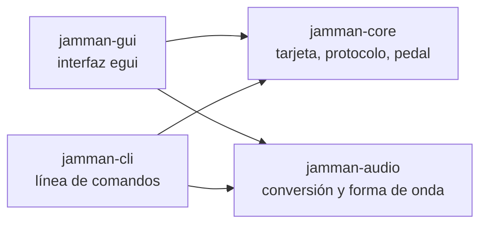
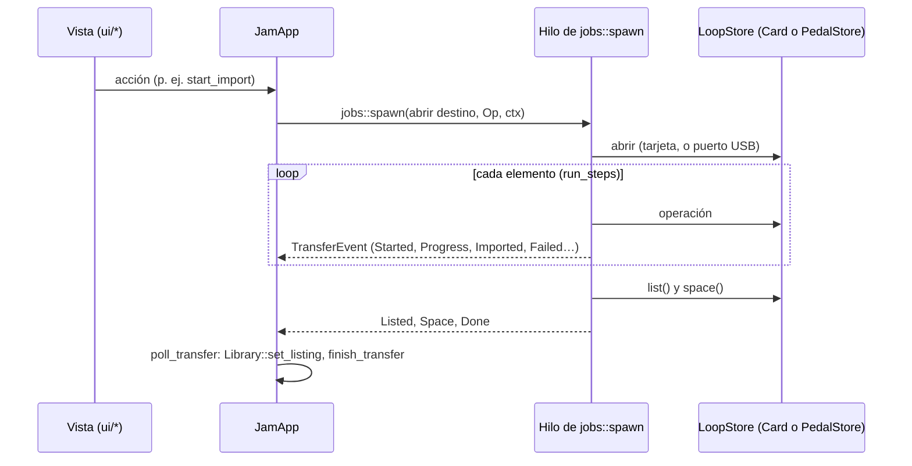

# Cómo funciona el programa

Visión general para quien llega al código: qué hace, cómo guarda los bucles
el pedal, cómo se leen y escriben, cómo está organizado el código Rust y qué
funciones se ejecutan en un uso normal. El detalle está en los otros
documentos: [03-protocolo.md](03-protocolo.md) (USB),
[04-tarjeta-sd.md](04-tarjeta-sd.md) (formato de la tarjeta) y
[02-decisiones.md](02-decisiones.md) (el porqué de cada decisión).

## 1. Objetivo

Sustituir al programa original de DigiTech (JamManager XT, solo Windows y ya
sin mantenimiento) por uno propio, libre y multiplataforma (Linux y Windows),
para gestionar los bucles del **DigiTech JamMan Stereo**:

- ver los bucles con sus ajustes (tempo, compás, modo, ritmo, parada…);
- añadir canciones convirtiéndolas solas al formato del pedal;
- escuchar, editar ajustes, mover, exportar y borrar;
- hacer y restaurar copias de seguridad.

Funciona de dos maneras, con el mismo modelo de datos:

| Destino | Cómo se accede | Para qué |
|---|---|---|
| **Tarjeta SD en el PC** | Sistema de ficheros normal | Lo habitual: rápido, sin pedal |
| **Pedal por USB** | Puerto serie y protocolo propio del pedal | Memoria interna y tarjeta puesta en el pedal |

## 2. Cómo guarda el pedal los bucles

### Dos almacenes de 99 posiciones

El pedal tiene **memoria interna** (unos 35 minutos) y una **tarjeta SD/SDHC**
opcional (FAT32, hasta 32 GB). Cada una tiene 99 posiciones (`Slot` 1..=99).
Las dos usan exactamente la misma estructura de carpetas:

```
JamManStereo/
├── Patch01/
│   ├── patch.xml          Ajustes del bucle: nombre, tempo, modo, ritmo, parada…
│   └── PhraseA/
│       ├── phrase.xml     Datos de la grabación: BPM, compás, identificadores
│       └── phrase.wav     El audio
├── Patch02/
└── …
```

- Una posición ocupada es una carpeta `PatchNN`. Las que faltan están libres.
- El audio es siempre **WAV PCM, 44,1 kHz, 16 bit, estéreo**, de 10 minutos
  como máximo (`jamman_core::audio`).
- Los XML se reescriben **byte a byte como el software original** (fin de
  línea CRLF, sin BOM). Al editar solo se tocan las etiquetas que cambian
  (`card::xml`) para no estropear nada que el pedal espere.
- Una posición puede tener ajustes sin audio («solo ajustes»): se lista como
  bucle con error y no se exporta.

En la tarjeta del PC la ruta es `<punto de montaje>/JamManStereo/`. Dentro
del pedal, por USB, es `/mnt/nandfs/JamManStereo` (interna) o
`/mnt/sdfs/JamManStereo` (tarjeta) (`pedal::Storage::root`).

### Leer y escribir en la tarjeta (PC)

Son operaciones de ficheros normales, con dos precauciones:

- **Escritura atómica**: un bucle nuevo se construye en una carpeta temporal
  `.tmp-PatchNN` y solo al final se renombra a `PatchNN`. Si algo falla
  (tarjeta llena, se saca), no queda un bucle a medias.
- **Verificación**: tras copiar, se relee lo escrito **sin la caché del
  sistema** (`card::verify`, `O_DIRECT` en Linux). Así se detectan tarjetas
  averiadas que aceptan las escrituras pero no las guardan.

### Leer y escribir en el pedal (USB)

El pedal aparece como un puerto serie USB (CDC-ACM, `1210:0020`, en Linux
`/dev/ttyACM0`). Por él habla un protocolo binario de petición y respuesta
(llamado «Greenglass» en el original), deducido por ingeniería inversa y
validado con el pedal:

```
cabecera (10 bytes, little-endian)        carga
┌────────────┬──────────────┬───────────┬───────────────────────┐
│ tipo (u16) │ longitud(u32)│ serie(u32)│ depende del tipo      │
└────────────┴──────────────┴───────────┴───────────────────────┘
               (= 4 + carga)   (empareja petición y respuesta)
```

Las peticiones son operaciones de un sistema de ficheros remoto: listar
carpeta, información de una entrada, crear o borrar, abrir, leer, escribir y
cerrar un fichero (en bloques de 8169 bytes como máximo) y leer propiedades
(la 12 y la 13 dan los KB libres y totales de la tarjeta). Por eso la capa
del pedal reproduce encima la misma estructura de carpetas que la tarjeta.

Precauciones propias del USB:

- Al subir un bucle, `patch.xml` se escribe **el último**: el pedal no ve el
  bucle hasta que está completo, y si algo falla se borra la carpeta.
- El pedal **no avisa si no cabe**: se comprueba el espacio libre antes.
- Si el pedal deja de responder, la conversación ya no es fiable: se para
  todo (`Error::breaks_connection`).

## 3. Organización del código

Workspace de Cargo con cuatro crates. Las interfaces dependen del núcleo y
el núcleo no depende de ninguna interfaz:



### `jamman-core`: el núcleo, sin interfaz

| Módulo | Qué hace |
|---|---|
| `device` | Constantes del pedal (USB, 99 posiciones) y `Slot`, con `first_free_from` |
| `audio` | Formato de audio que acepta el pedal |
| `card` | La tarjeta en el PC: `Card` (abrir, listar, leer, importar, editar, mover, exportar, borrar, copias) |
| `card::meta`, `card::xml` | Leer y generar `patch.xml` y `phrase.xml` (`PatchMeta`, `PhraseMeta`) |
| `card::wav` | Cabecera WAV: duración y comprobación de formato |
| `card::options` | Valores de ritmo y modo de parada, con su texto |
| `card::verify` | Releer sin caché lo que se acaba de escribir |
| `protocol` | El protocolo USB sin E/S: `request`, `response`, `header`, `wire`, `property` |
| `protocol::client` | `Client<T: Read + Write>`: envía peticiones y espera sus respuestas; operaciones de ficheros |
| `protocol::fake` | `FakePedal`, pedal simulado para los tests |
| `pedal` | `PedalStore`: los bucles de un almacén del pedal, con la misma forma que `Card` |
| `serial` | Buscar y abrir el puerto del pedal (característica `serial`) |
| `store` | **`LoopStore`**: el trait común de `Card` y `PedalStore` |
| `error` | `Error` del núcleo |

La pieza central es `store::LoopStore`. Todo lo que se puede hacer con
bucles (listar, leer, importar, exportar, borrar, guardar ajustes, copiar a o
desde una copia de seguridad, espacio libre, verificar) está definido una
vez, y la tarjeta y el pedal lo implementan. Las interfaces trabajan con el
trait y no saben dónde están los bucles. Un test (`store.rs`) recorre los dos
con las mismas comprobaciones.

### `jamman-audio`: conversión

- `convert_to_pedal_wav`: decodifica MP3, FLAC, OGG, AIFF, M4A o WAV
  (`symphonia`), remuestrea a 44,1 kHz (`rubato`), pasa a estéreo y 16 bit y,
  si se pide, normaliza.
- `needs_conversion`: si el fichero ya está en el formato del pedal.
- `waveform`: picos para dibujar la forma de onda.

### `jamman-cli`: binario `jamman`

| Fichero | Qué hace |
|---|---|
| `main.rs` | Punto de entrada; reparte entre `card`, `pedal` y los comandos de bajo nivel (`ports`, `who-am-i`, `ls`, `get`…) |
| `card_cmd.rs` | `jamman card …`: abre una `Card` y añade lo propio de la tarjeta (`rename`, `mv`, `init`) |
| `pedal_cmd.rs` | `jamman pedal …`: abre un `PedalStore` con `serial::open_store` |
| `store_cmd.rs` | Comandos comunes sobre `&mut dyn LoopStore`: `ls`, `add`, `export`, `rm`, `backup`, `restore` |

### `jamman-gui`: binario `jamman-gui`

La lógica (estado y trabajos) está separada de las vistas, que solo dibujan
y llaman a métodos de `JamApp`:

| Fichero | Qué hace |
|---|---|
| `main.rs` | Punto de entrada: crea la ventana con `eframe` y `JamApp::new` |
| `app.rs` | `JamApp`: todo el estado y **las acciones** (abrir, importar, borrar, guardar…) |
| `state.rs` | `Library`: lo abierto (tarjeta o pedal), las filas, orden, búsqueda, selección y ajustes en edición |
| `jobs.rs` | **Trabajos en segundo plano** sobre cualquier `LoopStore` (`spawn`, `Op`, `TransferEvent`) |
| `browser.rs`, `selection.rs` | Explorador de ficheros del equipo y selección múltiple genérica |
| `detect.rs`, `volume.rs` | Detectar tarjetas y unidades vacías; avisar de formatos que el pedal no lee |
| `player.rs`, `waveform_cache.rs` | Reproducción (`rodio`) y caché en disco de formas de onda |
| `ui/*` | Vistas: barra de herramientas, explorador, cabecera, tabla, panel de ajustes, diálogos |
| `theme.rs`, `fmt.rs`, `devshot.rs` | Colores, formatos de texto y capturas automáticas para desarrollo |

## 4. Puntos de entrada y bucle de la interfaz

**CLI**: `main::run` lee `--port`, mira el primer argumento y llama a
`card_cmd::run` o `pedal_cmd::run`. Estos abren el destino y llaman a la
función común de `store_cmd`. Todo es síncrono y termina al acabar.

**GUI**: `main` arranca `eframe`, que llama a `JamApp::new` una vez y después
a dos métodos en cada fotograma:

- `JamApp::logic`: recoge los mensajes de los trabajos en segundo plano
  (`poll_transfer`, `poll_waveforms`) y pide repintar mientras suena el
  reproductor.
- `JamApp::ui` → `ui::show`: dibuja los paneles y atiende atajos de teclado y
  ficheros soltados. Las vistas no modifican nada por sí mismas: llaman a
  métodos de `JamApp`.

Las operaciones lentas (copiar, convertir, todo lo del USB) nunca bloquean la
ventana. Siguen este patrón:



`JamApp::start` elige cómo abrir el destino: para la tarjeta, un clon de la
`Card`; para el pedal, `serial::open_store`, que abre el puerto **dentro del
hilo** y lo cierra al acabar. A partir de ahí el trabajo (`jobs::run_op`) es
el mismo para los dos.

## 5. Un recorrido completo (GUI)

### Arrancar y detectar

1. `JamApp::new` llama a `detect::find`, que busca unidades montadas con la
   carpeta `JamManStereo` (y unidades vacías que se podrían preparar), y a
   `serial::find_pedal`, que busca el puerto `1210:0020`.
2. Si hay una sola tarjeta, la abre. Si no hay ninguna pero está el pedal,
   abre la tarjeta del pedal.

### Abrir una tarjeta y leer los bucles

1. `JamApp::open_card` → `Library::open` → `Card::open` (comprueba que
   exista `JamManStereo/`).
2. `Library::reload` → `Card::list`: recorre las carpetas `PatchNN` y, para
   cada una, `Card::read`:
   - `PatchMeta::parse` (`patch.xml`) y `PhraseMeta::parse` (`phrase.xml`);
   - `wav::read_info` (solo la cabecera del WAV, para la duración).
3. `Library::set_listing` convierte cada bucle en una fila (`Row`), mantiene
   la selección y los cambios sin guardar.
4. `volume::check` avisa si la tarjeta tiene un formato que el pedal no lee.
5. Al seleccionar una fila (`Library::click`) se rellena el panel de ajustes
   (`Draft`). Con doble clic, `JamApp::play` → `Player::play`. La forma de onda
   se calcula aparte (`jobs::spawn_waveform` y `waveform_cache`).

### Añadir unas canciones a la SD

1. En el explorador (`ui::browser`) se seleccionan ficheros y se pulsa
   «Añadir»: `JamApp::start_import`.
2. `audio_files` expande carpetas y filtra el audio. `import_blocked` e
   `import_slot` comprueban la posición de inicio elegida.
3. `JamApp::start(Op::Import { files, normalize, start })` → `jobs::spawn`.
4. En el hilo, `run_op` → `run_steps`, para cada fichero:
   1. `device::first_free_from(store.slots(), start)`: primer hueco libre
      desde la posición elegida;
   2. `prepare_wav` → `jamman_audio::convert_to_pedal_wav` (si hace falta),
      en una carpeta temporal;
   3. `LoopStore::import_wav_from` → `Card::import_wav_from`: comprueba el
      formato (`WavInfo::check_pedal_format`), genera los XML
      (`imported_meta`), copia el audio a `.tmp-PatchNN` y renombra;
   4. `LoopStore::verify_loop` → `Card::verify_loop`: relee sin caché;
   5. envía `TransferEvent::Imported(slot)`.
5. Al final el hilo envía la lista nueva (`Listed`). `poll_transfer` la
   aplica y `finish_transfer` resume el resultado («6 añadidas, 0 con
   error…»). Los errores se muestran en un diálogo.

### Editar, mover, exportar y borrar

| Acción | Cadena de llamadas |
|---|---|
| Guardar ajustes | `JamApp::save` → `Op::Update` → `Card::update` (solo cambia las etiquetas afectadas de los XML) |
| Mover / intercambiar | `JamApp::move_or_swap` → `Card::swap` (renombrar carpetas; solo en la tarjeta del PC) |
| Exportar al explorador | `JamApp::export_to_browser` → `Op::Export` → `LoopStore::export_wav` (nunca sobrescribe: `unique_path`) |
| Borrar | diálogo → `JamApp::delete` → `Op::Remove` → `LoopStore::remove`; después se selecciona el siguiente (`Library::next_after_removal`) |
| Copia de seguridad | `JamApp::backup` → `Op::Backup` → `LoopStore::backup_loop` hacia una `Card` en una carpeta del equipo |

### Lo mismo con el pedal

Desde el selector de la cabecera, `JamApp::open_pedal` muestra el almacén y
lanza `Op::List`. Todo lo anterior funciona igual (salvo escuchar y mover),
pero `LoopStore` es un `PedalStore`:

- **Conectar**: `serial::open_store` → `serial::open` (115 200 baudios, DTR)
  → `Client::new` → `PedalStore::open` (comprueba que el almacén exista).
- **Listar**: `PedalStore::slots` (`Client::folder_contents`) y, para cada
  bucle, `PedalStore::read`: descarga los dos XML y solo los primeros bytes
  del WAV (`Client::read_head` + `wav::parse_header`).
- **Añadir**: `PedalStore::import_wav_from` → `upload_loop`: comprueba el
  espacio (`PedalStore::space`, propiedades 12 y 13), crea las carpetas
  (`Client::create_folder`), sube el audio por bloques
  (`Client::upload_from`), después `phrase.xml` y por último `patch.xml`.
- Cada operación de `Client` acaba en `Client::call`: codifica la petición
  (`Request::encode`), la escribe, lee tramas (`read_frame`) hasta la que
  tiene su número de serie, descarta los mensajes asíncronos del pedal e
  interpreta la respuesta (`Response::parse`).

## 6. Errores

- El núcleo usa un único `jamman_core::Error`. Los mensajes están en español
  y pensados para el usuario.
- `Error::Connection` (el puerto falló o el pedal no responde) se distingue
  de `Error::Io` (un fichero del equipo). `Error::breaks_connection` decide si
  hay que parar una tanda.
- En la GUI, `run_steps` anota cada fallo (`TransferEvent::Failed`) y sigue
  con lo siguiente, salvo que se haya cortado la comunicación: entonces marca
  el resto como «no intentado» y para.

## 7. Tests

- `cargo test --workspace --all-features` ejecuta todo (unos 180 tests).
- El protocolo y el pedal se prueban sin hardware con `protocol::fake::FakePedal`,
  que responde con los formatos validados con el pedal real.
- La tarjeta se prueba con carpetas temporales (`tempfile`).
- `store.rs` comprueba que la tarjeta y el pedal se comportan igual.
- `jobs.rs` prueba los trabajos de la GUI de punta a punta, incluido un pedal
  que se cuelga a mitad de una copia.
- `examples/upload_latency.rs` y `examples/write_verify.rs` (en
  `jamman-core`) son diagnósticos contra el pedal real.

## 8. Dónde tocar para…

| Quiero… | Dónde |
|---|---|
| Un nuevo sitio donde guardar bucles | Implementar `LoopStore`: la CLI y la GUI lo usan sin más cambios |
| Un ajuste nuevo del bucle | `card::LoopSettings`, `card::apply_settings` y el panel `ui::details` |
| Un mensaje nuevo del protocolo | `protocol::request` y `protocol::response` (con test), y usarlo desde `Client` |
| Una acción nueva en la GUI | Método en `JamApp` (y, si es lenta, una variante de `jobs::Op`); la vista solo lo llama |
| Un comando nuevo en la CLI | `store_cmd.rs` si vale para los dos destinos; si no, `card_cmd.rs` o `pedal_cmd.rs` |
